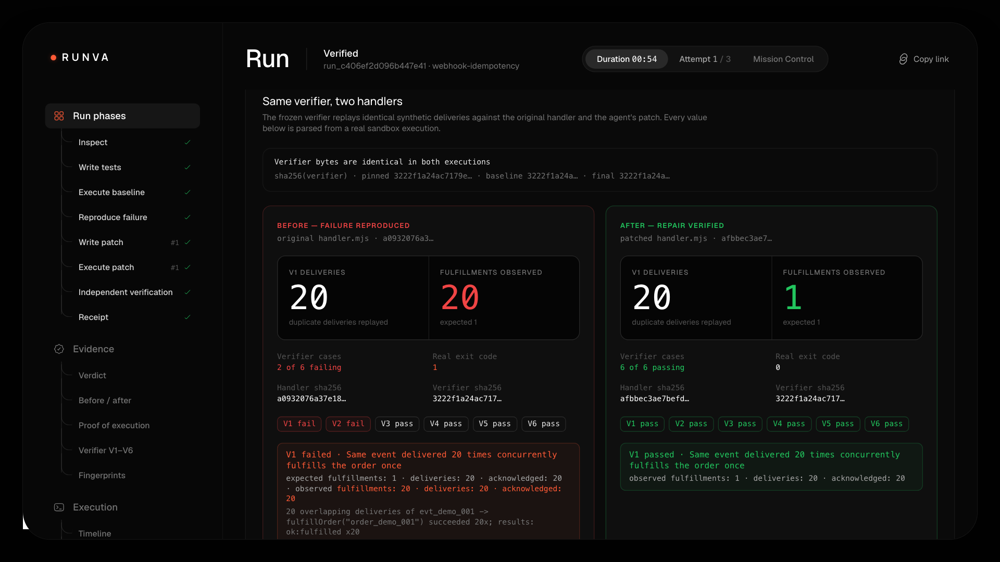
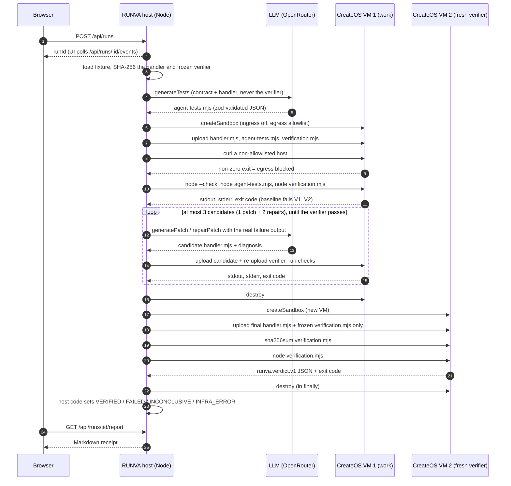

# RUNVA — Prove it before you ship

**The AI reliability engineer that breaks your integration, repairs it, and proves the repair in a real sandbox.**

▶️ **[Watch the 2-minute demo](https://youtu.be/tlN_ubezhjY)** (a real, unedited run) · **Live:** https://production-runva.tyzo.nodeops.app · **Evidence:** [`evidence/runs/`](evidence/runs/)

> The hosted app is on CreateOS. Starting a run there needs an access code, which is in the submission notes, so strangers can't spend sandbox credits. If the hosted run is unavailable, the video shows a real run end to end, and `evidence/runs/` plus `web/scripts/reverify.mjs` let you check every claim yourself.



> **Judges: the 60-second tour**
> 1. ▶️ **[2-minute video](https://youtu.be/tlN_ubezhjY)**: one real, unedited run, from the AI writing tests through VERIFIED in a fresh CreateOS VM.
> 2. **The result above:** the same frozen verifier and the same 20 concurrent deliveries; the original handler fulfills the order **20×**, the agent's patch **1×**.
> 3. **[Real Stripe event](#real-stripe-test-mode-event):** the same 20 → 1 on a Stripe-generated test-mode `payment_intent.succeeded`, replayed inside a CreateOS VM.
> 4. **[Twin-VM experiment](#twin-vm-experiment-pause--fork--resume):** CreateOS pause → fork → resume. In an identical snapshot with identical verifier bytes, only `handler.mjs` differs: **20 fulfillments vs 1**.
> 5. **[Bring your own handler](#bring-your-own-handler):** `e2e-run.ts --handler your-handler.mjs` runs the full loop on your code. A second, differently written vulnerable handler was VERIFIED: 20 → 1.
> 6. **[Why the judge can't be fooled](#why-the-judge-cant-be-fooled):** the model never grades itself. The verifier is frozen, hash-pinned, re-measured inside a brand-new VM, and tested against forged verdicts.
> 7. **[Evidence](evidence/runs/):** receipts from every real run (all VERIFIED), including diffs, agent-written tests and per-case results.
> 8. **Check it yourself:** `node web/scripts/reverify.mjs evidence/runs/run_9ce5ab644beb2546eb/patch.diff` re-runs the frozen verifier in your own fresh VM.

Webhooks get retried. One payment can trigger the same fulfillment twice — under duplicate delivery, concurrent delivery, or two event IDs for the same order. A happy-path test won't catch it, and an AI-suggested patch is just a suggestion.

RUNVA doesn't ask you to trust an AI patch. It:

1. **Writes adversarial replay tests** for the failure (LLM-generated, real code).
2. **Runs them against the original handler inside a CreateOS sandbox VM** and captures the real failure: stdout, stderr, exit code.
3. **Writes a minimal patch** from that evidence.
4. **Re-runs, and repairs its own patch** from the new failure output (up to 2 retries).
5. **Independently verifies** the final patch with a frozen, host-owned verifier (V1–V6) in a **fresh VM**.
6. Returns a **proof receipt**: before/after counts, diff, per-case assertions, SHA-256 identifiers. You can download it as Markdown.

A run is only marked **VERIFIED** when the unmodified verifier passes in a real CreateOS execution. Runs that fail, can't be reproduced, or hit an infrastructure error are labeled honestly as FAILED, INCONCLUSIVE or INFRA_ERROR.

**Contents:** [Golden scenario](#the-golden-scenario-duplicate-fulfillment) · [One run](#one-run-end-to-end) · [Architecture](#architecture) · [Design decisions](#why-this-is-hard--design-decisions) · [Sponsor integration](#sponsor-integration) · [Evidence](#evidence) · [Verify it yourself](#verify-it-yourself) · [API](#api) · [Run it locally](#run-it-locally) · [Scope of proof](#scope-of-proof)

## The golden scenario: duplicate fulfillment

`handler.mjs` exports `handleWebhook(event, deps)`. The seeded baseline *looks* idempotent: it dedupes on `event.id`. But the check happens before an `await` and is keyed on the wrong thing, so it fails under concurrency and under different event IDs for the same order.

**Contract** ([`invariant.md`](web/fixtures/webhook-idempotency/invariant.md)): one paid order leads to exactly one fulfillment, even when a webhook is delivered more than once, concurrently, or under a different event ID.

| Case | Replay scenario | Contract |
|---|---|---|
| V1 | Same event delivered 20× concurrently | Exactly 1 fulfillment |
| V2 | Two different event IDs for the same order | 1 fulfillment, not 2 |
| V3 | Unknown / non-paid event types | 0 fulfillments, acknowledged |
| V4 | Two different orders | Exactly 1 each |
| V5 | Fulfillment fails once, then retry | Not marked done early; retry fulfills once |
| V6 | Module interface | Export exists, no crash |

Observed baseline (frozen verifier, real execution): **V1 fails with 20 fulfillments from 20 deliveries**, and V2 fails. V3–V6 pass.

The verifier runs each case in an isolated `worker_thread` with a fresh module import. It counts side effects in its own closure, never from the handler's return value. It routes handler output to stderr so a patch can't forge the verdict line, and it treats unhandled rejections and timeouts as failures.

## One run, end to end



## Architecture

```text
Browser (Next.js UI)  ──  POST /api/runs · GET /api/runs/:id · cancel · report · patch
        │
Node server (trusted host)
  ├─ orchestrator: state machine, ≤3 patch attempts, one active run, timeout + cancel
  ├─ LLM adapter (OpenRouter): generateTests / generatePatch / repairPatch, zod-validated JSON
  ├─ frozen verifier + fixture (host-owned, SHA-256 pinned, never shown to the model)
  └─ CreateOS Sandbox SDK (server-only)
        │  create VM → upload → run → capture stdout/stderr/exit_code → destroy (finally)
        ▼
CreateOS Firecracker VM (EU, ephemeral, ingress off, egress allowlist)
  /workspace/target/handler.mjs   ← model-editable
  /workspace/agent-tests.mjs      ← model-generated
  /workspace/verification.mjs     ← frozen; hash re-checked inside the final VM
```

**Execution boundary:** model-generated code never runs on the host. There's no `eval`, `vm`, `child_process` or local import of candidate code. The host only hashes, diffs, and parses JSON.

Key files: [`orchestrator.ts`](web/src/lib/runva/orchestrator.ts) (state machine), [`sandbox.ts`](web/src/lib/runva/sandbox.ts) (CreateOS SDK), [`llm.ts`](web/src/lib/runva/llm.ts), [`verifier.ts`](web/src/lib/runva/verifier.ts) (host-side verdict parsing), [`receipt.ts`](web/src/lib/runva/receipt.ts), [`types.ts`](web/src/lib/runva/types.ts) (shared contract), [`fixtures/webhook-idempotency/`](web/fixtures/webhook-idempotency/).

## Why the judge can't be fooled

Most agent demos let a model, or a second agent, decide whether the fix worked. In RUNVA the model never decides pass or fail:

| Attack on the verdict | What stops it | Tested in |
|---|---|---|
| Patch prints a fake `{"pass":true}` line | Handler output goes to stderr, and only the verifier's **last** stdout line counts | `web/tests/fixture-integrity.test.ts`, `web/tests/verifier-parse.test.ts` |
| Patch special-cases the test (reads its own URL or state) | Each case runs in its own `worker_thread` with a fresh module import; counts come from the verifier's own closure, never from the handler's return value | `fixture-integrity.test.ts` |
| Patch hangs or busy-loops | 2.5 s per-case timeout, workers terminated at 4 s, and the case fails | `fixture-integrity.test.ts` |
| Model edits the verifier | It never sees the verifier source, can only write `handler.mjs`, and the verifier's SHA-256 is pinned on the host and **re-measured inside the final VM** | `summary.verifierIntegrity` in every receipt |
| "It passed in a VM that the model's code had already touched" | The work VM is destroyed. The final verdict runs in a **brand-new VM** holding only the final handler and the frozen verifier | `summary.sandboxes` in every receipt |

**Fresh VM rather than fork, by design.** CreateOS can fork a paused sandbox snapshot (we use exactly that in the [twin-VM experiment](#twin-vm-experiment-pause--fork--resume)), but a fork inherits files and state that the model's code has already touched. For the verdict we deliberately use a clean VM with nothing inherited.

**Exit code and JSON must agree.** A run is VERIFIED only if the verdict JSON parses, all of V1–V6 are present and passing, *and* the process exit code is 0. Anything else is FAILED, INCONCLUSIVE or INFRA_ERROR, and is shown as such.

## Why this is hard / design decisions

**The LLM never decides pass/fail.** A model grading its own patch gives you a confidence score, not evidence. The model writes tests and patches, and its diagnosis is shown as a claim. `VERIFIED` is computed by host code from the frozen verifier's exit code, its parsed `runva.verdict.v1` JSON, and the in-VM verifier hash. The model's own tests count as evidence that the bug was reproduced. They don't gate the verdict, because a model can write weak tests that its own patch passes.

**The verifier is frozen, hash-pinned, and runs each case in a worker.** If the patching model could see or edit the judge, it could optimize for the judge instead of the contract. So the verifier lives in the host repo and its source is never sent to the model. The model only sees its failure output, which is the evidence it repairs from. It's re-uploaded before every candidate run, so a candidate can't overwrite it in between, and its SHA-256 is pinned on the host and measured again inside the final VM. Each case runs in its own `worker_thread`, which gives three guarantees: module-level state from one case (a dedupe `Set`, say) can't leak into the next and make it pass by accident; a synchronous busy-loop gets hard-killed instead of hanging the run; and fulfillments are counted in a closure the handler can't reach.

**The final verdict uses a fresh VM.** By the end of the repair loop, the work VM has run model-written tests and up to three candidates. Anything they left behind (stray files, background work, a modified `verification.mjs`) could affect a re-run in the same VM. The final VM holds only the final handler and the frozen verifier, so nothing the model's code touched is in the room. The work VM is destroyed first, and every VM is destroyed in `finally` on success, failure, timeout and cancel. If a create call times out, RUNVA cleans up the orphan by its unique run-scoped name.

**Egress is an allowlist, not an empty list.** On CreateOS, `egress: []` means *allow all*, not deny all. RUNVA always passes a non-empty allowlist (default `registry.npmjs.org:443`; an empty value or `*` in `RUNVA_SANDBOX_EGRESS` falls back to that default), with ingress disabled. The handler only uses Node built-ins, so it needs no network. Every run then proves the restriction from inside the VM with a `curl` to a non-allowlisted host (`example.com`) and records the exit code in the receipt.

**Bounded and honest by construction.** One active run globally, at most 3 candidates, a run timeout, and cancel. When the loop doesn't converge, the run ends as `FAILED` with the real outputs attached, not as a softened success. When the baseline doesn't fail, the run is `INCONCLUSIVE`, because there's nothing to repair.

## Sponsor integration

- **CreateOS Sandbox** (`@nodeops-createos/sandbox`): every test, baseline and patch run happens in a real Firecracker microVM. A work VM handles baseline and repair, then a **fresh VM** runs the final independent verification. Egress is restricted to an allowlist; each run proves it by attempting an outbound request to a non-allowlisted host from inside the VM. VMs are destroyed in `finally` on success, failure, timeout and cancel. SDK surface used: `createSandbox` (shape, rootfs, `ingress_enabled: false`, `egress`), `files.upload`, buffered `runCommand` (stdout, stderr, `exit_code`, `exec_ms`), `destroy`.
- **CreateOS hosting**: the RUNVA app itself is deployed on CreateOS.
- **Stripe Projects**: the repo is a Stripe Projects workspace (`.projects/state.json`) with the CreateOS provider linked and the `createos/free` plan and `createos/project` resources provisioned via `stripe projects`. Run `stripe projects status` to see the linked stack. No live-mode Stripe calls, real payments or customer data. The main RUNVA loop uses synthetic events, and a separate [real Stripe test-mode replay](#real-stripe-test-mode-event) shows the same 20 → 1 result on a Stripe-generated `payment_intent.succeeded` event.

## Evidence

Real run receipts are committed in [`evidence/runs/`](evidence/runs/). Each one is a receipt downloaded after a real run, from `GET /api/runs/:id/report` (Markdown) or `GET /api/runs/:id/receipt.json`. It records the run status, the CreateOS sandboxes used (shortened IDs, shape, region, destroyed or not), the egress check, each command with its exit code and output tail, frozen-verifier results against the baseline and the final candidate, every patch attempt, the code diff, and SHA-256 identifiers.

For actual counts, durations and attempt numbers, see `evidence/runs/`. This README doesn't restate them, so it can't drift from the receipts.


### Real results (5 runs, October 17, 2026)

Every row is a real run: CreateOS EU sandbox VMs plus OpenRouter `anthropic/claude-sonnet-5.5`. Receipts for the CLI runs are in [`evidence/runs/`](evidence/runs/).

| Run | Path | Status | Patch attempts | Total time | V1 fulfillments before → after | Egress blocked | Verifier hash in VM |
|---|---|---|---|---|---|---|---|
| `run_9ce5ab644beb2546eb` | CLI e2e | VERIFIED | 1 | 66.5 s | 20 → 1 | ✓ (curl exit 35) | match |
| `run_88c5e7d33d000c950b` | CLI e2e | VERIFIED | 1 | 51.8 s | 20 → 1 | ✓ | match |
| `run_d0ac7124a7992a5f40` | CLI e2e | VERIFIED | 1 | 46.1 s | 20 → 1 | ✓ | match |
| `run_d6607067daacf459e2` | Web API | VERIFIED | 1 | ~40 s | 20 → 1 | ✓ | match |
| `run_5ccdc7a1332e0c2ad0` | Web UI (prod build) | VERIFIED | 1 | 53 s | 20 → 1 | ✓ | match |

The model wrote three different patches (sha256 prefixes `f2cbd018`, `21364f4a`, `c6b0b603`), and every one passed the frozen verifier in a fresh VM. VMs were created in 0.3–3.2 s and destroyed in ~0.2 s. `scripts/reverify.mjs` independently re-ran the frozen verifier against the `run_9ce5…` patch in a separate VM: 6/6 pass, exit 0. The repair loop (attempts 2–3) exists and is tested on the host, but no real run needed it.

## Real Stripe test-mode event

This is a separate proof. The main RUNVA loop still uses synthetic events. `web/scripts/stripe-replay.mjs` creates a real Stripe **test-mode** PaymentIntent ($29.00 USD, `pm_card_visa`, confirmed) and fetches the `payment_intent.succeeded` event that Stripe generated for it. No real money moved. Inside one fresh CreateOS VM, a host-owned harness then delivers that same event 20× concurrently (the way Stripe retries redeliver one event id) to the original handler and to the agent-patched handler from `run_9ce5ab644beb2546eb` (sha256 `f2cbd018…`, re-measured inside the VM), and counts fulfillments in its own closure. On the recorded run (event `evt_3URiVpArkM5UmT2o0djTA2hQ`), the original handler fulfilled the order **20 times** and the patched handler fulfilled it **once**, with all 20 deliveries acknowledged by both. The saved event is Stripe's own payload with only `request` dropped and `client_secret` blanked: [`evidence/stripe/2026-10-18T01-03-46-557Z/`](evidence/stripe/2026-10-18T01-03-46-557Z/).

```bash
set -a; . ./.env; set +a   # STRIPE_TEST_SECRET_KEY (must start with sk_test_) and CREATEOS_SANDBOX_API_KEY
node web/scripts/stripe-replay.mjs
```

## Twin-VM experiment (pause · fork · resume)

`web/scripts/twin-vm.mjs` is a separate controlled experiment built on CreateOS snapshots: it loads the frozen verifier and the original handler into VM A, where the verifier exits 1 and V1 fulfills the order **20 times**. The script then pauses A, which snapshots that failing state, and forks the paused A into VM B (CreateOS only forks a paused sandbox). Inside B, the verifier sha256 `3222f1a2…` and a random nonce written before the pause both read back identical, and the script overwrites only `target/handler.mjs` with the agent patch from `run_9ce5ab644beb2546eb` (`f2cbd018…`). The same verifier bytes then pass 6/6 with exit 0 and **1** fulfillment, while A, resumed and re-run on its untouched baseline, still exits 1 with 20 fulfillments. Recorded run: pause 3.7 s, fork to running 6.5 s, resume 1.5 s, both VMs destroyed in 0.19 s each, 19 s total ([`evidence/twin-vm/2026-10-18T01-15-27-195Z/`](evidence/twin-vm/2026-10-18T01-15-27-195Z/)). The main RUNVA verdict still runs in a fresh VM, not a fork, on purpose, so that the judge inherits nothing from the VM where the model's code ran.

```bash
set -a; . ./.env; set +a   # CREATEOS_SANDBOX_API_KEY
node web/scripts/twin-vm.mjs
```

## Bring your own handler

The CLI can run the full autonomous loop against your own webhook handler instead of the bundled `handler.vulnerable.mjs`. The loop is the same: the LLM writes tests, CreateOS runs the baseline, the model patches and repairs, and the frozen verifier judges in a fresh VM. Your file becomes the baseline. The verifier, the invariant and the pinned verifier hash don't change.

```bash
cd web
set -a; . ../.env; set +a   # CREATEOS_SANDBOX_API_KEY + OPENROUTER_API_KEY
NODE_OPTIONS=--conditions=import pnpm dlx tsx scripts/e2e-run.ts --handler path/to/your-handler.mjs
```

The handler has to follow the contract that the frozen verifier V1–V6 encodes (see [`invariant.md`](web/fixtures/webhook-idempotency/invariant.md)):

- `export async function handleWebhook(event, deps)` resolves `{ ok, action: "fulfilled" | "duplicate" | "ignored" }`.
- `deps.fulfillOrder(orderId)` is async and may throw. The order id is at `event.data.object.metadata.order_id`.
- Only `payment_intent.succeeded` fulfills. Other event types are acknowledged as `ignored`.
- It must be one ES module that uses only Node built-ins. Before any VM is created, the CLI checks that the file exists, is at most 40 KB and contains `handleWebhook`.

**Example run.** [`web/examples/handlers/orders-db-handler.mjs`](web/examples/handlers/orders-db-handler.mjs) is a second, differently written vulnerable handler. It keeps an in-memory orders table, skips orders whose status is already `fulfilled`, and only sets that status after `fulfillOrder` succeeds. It looks idempotent, but the check and the write sit on either side of an `await`. Run `run_8dafcc4d7b6739ea49` ended **VERIFIED** in 55.1 s with 1 patch attempt. On the baseline, V1 fulfilled the order **20** times and V2 fulfilled it **2** times, while V3–V6 passed. The model's patch adds a per-order in-flight promise and makes the check-and-register step synchronous. In a fresh VM it passed 6/6 with **1** fulfillment, and the verifier sha256 measured inside that VM matched the pinned hash. `summary.json` and `receipt.json` record `baselineOrigin: { kind: "user", label, sha256, bytes }`. Evidence: [`evidence/runs/run_8dafcc4d7b6739ea49/`](evidence/runs/run_8dafcc4d7b6739ea49/). No fixed version of the example exists in the repo; the fix comes from the model.

**Security.** The web demo never accepts uploaded code: `POST /api/runs` takes only `{ scenarioId, accessCode }`, and only the CLI flag can set a custom baseline. The CLI reads your file as text, hashes it and uploads it only into the CreateOS sandbox. The host never imports or runs it.

## Verify it yourself

```bash
# From the repo root.
# Host tests, including fixture integrity (pinned hashes of the verifier and baseline)
(cd web && pnpm test)

# Re-run the frozen verifier against any handler in a fresh CreateOS VM
# (needs CREATEOS_SANDBOX_API_KEY in the environment)
set -a; . ./.env; set +a
node web/scripts/reverify.mjs <handler.mjs>          # or a RUNVA patch.diff
node web/scripts/reverify.mjs <handler.mjs> --expect-sha256 <hex>   # also pin the handler hash from a receipt
```

Point `reverify.mjs` at the final handler (or the `.diff` from `GET /api/runs/:id/patch`) to get an independent verdict that never touches the LLM, RUNVA's server or its UI. Exit codes: `0` PASS (V1–V6 pass, verifier exit 0), `1` FAIL, `2` usage error or hash mismatch, `3` infra error. Point it at `web/fixtures/webhook-idempotency/handler.vulnerable.mjs` to reproduce the baseline failure (V1 and V2 should fail).

## API

| Endpoint | Returns | Notes |
|---|---|---|
| `POST /api/runs` | `201 { runId, status }` | Body `{ scenarioId: "webhook-idempotency", accessCode? }`. `401` bad access code, `409` a run is already active, `429` cooldown. Preset fixture only, no user-supplied code. |
| `GET /api/runs/:id` | `RunSummary` | Phase, attempts, sandboxes, egress check, verifier results, errors. Shape in [`types.ts`](web/src/lib/runva/types.ts). |
| `GET /api/runs/:id/events?after=<seq>` | `{ events, status, finished }` | Ordered timeline; reconnect with the last `seq`. |
| `POST /api/runs/:id/cancel` | `{ cancelled }` | Aborts the run; VMs are still destroyed. |
| `GET /api/runs/:id/report` | `text/markdown` download | The proof receipt. |
| `GET /api/runs/:id/receipt.json` | JSON download | Machine-readable receipt (schema `runva.receipt.v1`). |
| `GET /api/runs/:id/patch` | `text/x-diff` download | Unified diff plus the complete final `handler.mjs`. |
| `GET /api/health` | `{ ok, sandboxConfigured, llmConfigured, model, activeRunId }` | Readiness only. Never returns keys or account data. |

## Run it locally

```bash
cd web
pnpm install
cp ../.env.example ../.env   # fill CREATEOS_SANDBOX_API_KEY and OPENROUTER_API_KEY
set -a; . ../.env; set +a
node scripts/smoke-sandbox.mjs   # Gate 1: real VM hello-world, nonzero exit, egress check
pnpm dev                         # http://localhost:3000
```

Environment variables (names only; see `.env.example`): `CREATEOS_SANDBOX_API_KEY`, `CREATEOS_SANDBOX_BASE_URL`, `OPENROUTER_API_KEY`, `OPENROUTER_MODEL`, `RUNVA_MAX_RUN_MS`, `RUNVA_FRESH_VERIFIER_VM`, `RUNVA_ACCESS_CODE`. Optional: `RUNVA_SANDBOX_EGRESS`, `RUNVA_SANDBOX_SHAPE`, `ANTHROPIC_API_KEY` / `ANTHROPIC_MODEL` (used when no OpenRouter key is set).

## Scope of proof

Verified for these synthetic conditions in this sandbox — **not a production guarantee**. The fixture is single-process; production durability requires a transactional/idempotent datastore and isn't covered across process crashes or multiple instances. Hashes identify artifacts; they aren't proof of correctness. Run state is in memory and is lost on server restart.

Built from scratch for *Build Agents That Run Code — CreateOS × Stripe Projects*, October 17, 2026.
